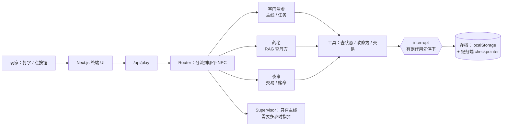

# Design — 幽冥修仙 MUD

## 一句话架构
Next.js 前端（终端 UI）→ Next API Route（LangGraph Agent）→ step_5_preview；
状态存在服务端内存 + localStorage 存档，数值规则是纯函数、可单测。



> Router 只分流一步、分完下场；Supervisor 全场在线、只走需要的节点。
> 这就是你 10 月 28 日跑通的那套，不用再发明新分法。

## 目录结构（新仓库，从空开始）
```
youming-mud/
├── .kiro/
│   ├── specs/youming-mud/        # requirements / design / tasks（本目录）
│   └── steering/                 # world-bible / agent-friendly / tech
├── app/
│   ├── page.tsx                  # 终端首页：剧情 + 输入框 + 状态栏
│   └── api/play/route.ts         # 唯一 Agent 入口
├── lib/
│   ├── game/state.ts             # 状态类型 + 初始值（生命/灵力/精力/修为/攻击）
│   ├── game/rules.ts             # 纯函数：升级、扣费、移动、重伤（可 PBT）
│   ├── game/knowledge.ts         # 丹方 / 功法知识库（RAG 数据源）
│   └── agent/
│       ├── graph.ts              # LangGraph：Router → 3 NPC → 工具
│       ├── npcs.ts               # 3 NPC 人设 + 工具集（互不重叠）
│       └── guardrails.ts         # schema 校验 + 护栏（每步一个）
├── components/
│   ├── Terminal.tsx              # 打字机 + 消息流
│   ├── StatusBar.tsx             # 生命/灵力/精力/修为
│   └── ConfirmCard.tsx           # interrupt 确认卡
└── tests/
    ├── rules.test.ts             # 数值单测
    └── rules.property.test.ts    # PBT：修为/交易/掉落
```

## 状态机
```ts
type Realm = '炼气初期' | '炼气中期' | '筑基';
type GameState = {
  name: string;
  realm: Realm;
  hp: number;       // 生命，上限 168
  mp: number;       // 灵力，上限 111
  energy: number;   // 精力，上限 100，每 10 分钟 +1
  cultivation: number; // 修为，500 升中期、1500 筑基
  attack: number;
  location: '宗门大殿' | '鬼市' | '幽冥渡口';
  quests: Record<string, '未接' | '进行中' | '已完成'>;
  inventory: string[];
};
```

## 剧情线（只做这些）
- 主线「渡口引魂」：掌门发任务 → 鬼市找夜枭换引魂灯（interrupt 确认）→ 渡口引魂 → 回大殿结算，修为 +300
- 支线 1「药老的丹方」：药老 RAG 查丹方 → 收集 3 味药 → 炼丹，修为 +120
- 支线 2「夜枭的赌局」：鬼市赌命换宝，赢了得法器、输了扣生命（interrupt 确认，幂等）

## 工具清单（每个 NPC 只拿自己的）
| NPC | 工具 | 有副作用？ |
|---|---|---|
| 掌门清虚 | `get_quest`、`complete_quest`、`get_player_state` | 结算任务是 → 走 interrupt |
| 药老 | `search_knowledge`、`brew_pill` | 炼丹是 → 走 interrupt |
| 夜枭 | `list_goods`、`trade`、`gamble` | 交易 / 赌命是 → 走 interrupt |

通用原则（你第 5 周那 4 条，直接复用）：
1. `search_knowledge` 先查、再答，不编
2. `validateToolArgs`：参数先对 schema，不对就拒，不调模型重猜
3. 接口幂等：`trade` / `gamble` / `brew_pill` 都带 `requestId`，同一 ID 只执行一次
4. 有副作用的操作放在 `interrupt()` 之后

## 护栏（每步一个）
- 输入：指令长度、敏感词、数值越界先拦
- 工具参数：schema 校验，不过就返回修正提示（提示文案直接取自 schema 描述）
- 输出：NPC 回答必须包含地点 / 状态变化可解析的字段，否则重试一次
- 数值：`rules.ts` 收口，生命 / 修为不出现负数、超上限

## 部署与密钥
- Vercel 部署，`STEP_API_KEY` 放 Vercel 环境变量，不进仓库、不进前端
- 演示走服务端代理，前端看不到 key
- 失败兜底：模型超时 → 返回「灵力不稳，稍后再试」+ 重试按钮

## 不做的
多人联机、3D、语音、开放大地图、第 4 NPC、第 4 地点。
